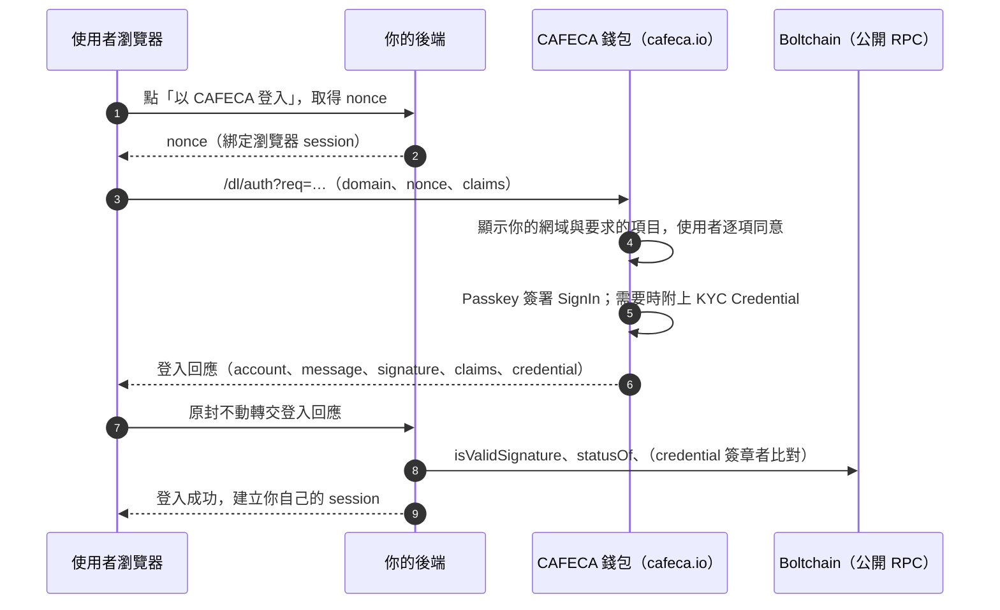

# 第三方服務串接指南：取得用戶授權、用戶資訊與 KYC 資料

這份指南說明你的網站或 App 如何：

1. 讓使用者以 CAFECA 登入，並**經使用者同意**取得授權；
2. 取得使用者的基本資訊（帳戶 ID、代稱）；
3. 取得使用者的 **KYC 資料**：實名等級、證件姓名等可驗證資料，以及在法定情形下調閱完整實名資料。

協定細節（欄位定義、EIP-712 結構、簽章版面）在根目錄 [README](../README.md)〈Sign in with CAFECA〉第 4、5、9 節；HTTP 端點規格在 [api/public.md](api/public.md)。本文把它們串成完整的串接流程。

---

## 先決定你需要什麼

| 你需要 | 取得方式 | 需要向 CAFECA 申請嗎 | 使用者要同意嗎 |
|---|---|---|---|
| 識別使用者（登入） | Sign in with CAFECA → `account` | 不需要 | 是：每次登入以 Passkey 簽署 |
| 顯示名稱 | claim `handle` | 不需要 | 是：逐項同意 |
| 是否已實名、是否為公司 | claim `kyc_level`，或登入後隨時查鏈上 IdentityRegistry | 不需要 | `kyc_level` 要同意；鏈上狀態是公開的 |
| 證件姓名、證件類型、國籍 | claims `legal_name`、`doc_type`、`nationality`（KYC Credential） | 不需要 | 是：逐項同意，預設全部關閉 |
| 辨識「是不是同一個人」（一人多帳戶、黑名單） | claim `pairwise_id` | 不需要 | 是 |
| 公司統編、登記名稱 | claims `entity_ubn`、`entity_name`（以公司身分登入時） | 不需要 | 是 |
| 生日、性別、發證日期、驗證歷程、證件影像、法人成員 | [資料調閱 API](#層級-3資料調閱-api法定情形) | **需要**：登記依賴方並簽署 DPA | 依法律依據：`consent` 類要同意；洗錢防制與司法調閱經雙人覆核 |
| 請使用者簽署文件或付款 | 登入時開啟簽章通道 | 不需要 | 是：每一筆都要確認 |

生日、證號、住址**不會**透過登入提供。生日只能經資料調閱 API 取得；證號與住址兩種方式都不提供。

---

## 整體流程



CAFECA 伺服器**不參與驗證**：你的後端只需要讀公開鏈上資料。CAFECA 也不發 access token，登入後的 session 由你的網站自行管理。

---

## 步驟 1：準備

不需要向 CAFECA 註冊、申請 client ID 或 API key。

1. **讀取設定**：`GET https://cafeca.io/.well-known/cafeca-configuration`，取得錢包入口、chainId、公開 RPC 與合約位址（[格式](api/public.md#well-knowncafeca-configuration)）。官方 SDK 會自動讀取，不要把位址寫死。
2. **網站資訊（選填）**：在 `https://<你的網域>/.well-known/cafeca-site.json` 放上 `{ "name": "Example Shop", "icon": "/icon.png" }`，並加上 `Access-Control-Allow-Origin: *`。錢包會標示為「網站自稱」，畫面永遠以網域為主。
3. **取得 SDK**：
   - 前端：`<script src="https://cafeca.io/sdk/cafeca-connect.js"></script>`
   - 後端（Node.js）：複製 [`app/sdk/cafeca-verify.ts`](../app/sdk/cafeca-verify.ts) 與 [`app/src/lib/signin.ts`](../app/src/lib/signin.ts)，只依賴 `viem`。
   - 其他語言：依 [README 第 4 節](../README.md) 的協定自行實作驗證（本文也列出步驟）。

---

## 步驟 2：索取用戶授權

### 2.1 後端發 nonce

nonce 必須**綁定瀏覽器 session、只能用一次、5 分鐘內有效**。

```ts
import { newNonce } from "./cafeca-verify";

app.post("/api/cafeca/nonce", (req, res) => {
  const nonce = newNonce(); // 128-bit，base64url
  req.session.cafecaNonce = { nonce, exp: Date.now() + 5 * 60_000 };
  res.json({ nonce });
});
```

### 2.2 前端發出登入請求，列出要索取的項目

```html
<script src="https://cafeca.io/sdk/cafeca-connect.js"></script>
<script>
  const cafeca = CafecaConnect.create({ wallet: "https://cafeca.io" });

  loginButton.onclick = async () => {
    try {
      // 必須在點擊事件中呼叫，否則彈出視窗會被擋下
      const response = await cafeca.signIn({
        nonce: () => fetch("/api/cafeca/nonce", { method: "POST" }).then((r) => r.json()).then((j) => j.nonce),
        statement: "登入 Example Exchange",
        claims: ["kyc_level", "handle", "legal_name", "nationality", "pairwise_id"],
      });
      // 前端拿到的結果不可信任，原封不動交給後端驗證
      await fetch("/api/cafeca/login", { method: "POST", headers: { "content-type": "application/json" }, body: JSON.stringify(response) });
    } catch (e) {
      // e.code：access_denied | closed | popup_blocked | timeout | invalid_nonce
    }
  };
</script>
```

可以索取的 `claims`：

| claim | 內容 | 來源 |
|---|---|---|
| `kyc_level` | 有效實名等級：0 或 2 | 鏈上 IdentityRegistry v2 |
| `handle` | CAFECA 代稱 | CAFECA 伺服器（`/api/profile`） |
| `legal_name` | 證件上的姓名 | KYC Credential |
| `doc_type` | `national_id`／`resident_permit`／`passport` | KYC Credential |
| `nationality` | ISO 3166-1 alpha-2，例如 `TW`（居留證暫不提供） | KYC Credential |
| `pairwise_id` | 同一人識別碼（bytes32） | KYC Credential |
| `entity_ubn`、`entity_name` | 統一編號、商工登記名稱（只在以公司身分登入時） | KYC Credential |

**只索取你真正需要的項目**。錢包的同意畫面會：

- 以你的**網域**為主標題，並列出每一項**實際要給出去的內容**（例如「陳大文」）；
- 實名資料**預設全部關閉**，由使用者逐項開啟；使用者可以拒絕任何一項；
- 讓使用者選擇以個人或公司身分登入。

### 2.3 回傳方式

| 方式 | 適用情境 | 呼叫 |
|---|---|---|
| `popup`（預設） | 桌機瀏覽器 | `cafeca.signIn({...})` |
| `redirect` | 行動裝置、App 內瀏覽器 | `cafeca.redirect({ nonce, redirectUri })`，回到頁面後 `CafecaConnect.handleRedirect()` |
| `post` | 跨裝置：電腦顯示 QR，手機掃描 | `cafeca.authLink({ nonce, mode: "post", responseUri })`，錢包把回應 POST 到你的後端 |

原生 App 可用 `cafeca://auth?v=1&req=<base64url(JSON)>`。請求欄位見 [README 第 4 節](../README.md)。

---

## 步驟 3：後端驗證並取得用戶資訊

```ts
import { createCafecaVerifier } from "./cafeca-verify";

const cafeca = createCafecaVerifier({ wallet: "https://cafeca.io" });
const DOMAIN = "https://exchange.example"; // 與瀏覽器網址列完全相同（含 scheme、port）

app.post("/api/cafeca/login", async (req, res) => {
  const saved = req.session.cafecaNonce;
  delete req.session.cafecaNonce; // 不論成功與否都先作廢
  if (!saved || saved.exp < Date.now()) return res.status(400).json({ error: "nonce 已過期" });
  try {
    const user = await cafeca.verify(req.body, { domain: DOMAIN, nonce: saved.nonce });
    req.session.userId = user.account;
    await saveSignInEvidence(user.account, req.body); // 原始回應：日後資料調閱證明客戶關係用（見層級 3）
    res.json({ account: user.account, name: user.claims.legal_name ?? user.claims.handle ?? null });
  } catch (e) {
    res.status(401).json({ error: (e as Error).message });
  }
});
```

`verify` 會檢查：

- 網域、nonce、chainId 與有效時間；
- `account.isValidSignature`（ERC-1271）；
- 實名狀態，以及 KYC Credential 的簽章者、範圍與時效。

任一項不符就拋錯。驗證成功回傳：

| 欄位 | 說明 |
|---|---|
| `account` | 使用者的身分合約地址。**用它當你系統裡的使用者主鍵**：換裝置、換 Passkey、恢復身分後都不會變 |
| `claims.handle` | 代稱，`handleVerified: true` 表示已向 CAFECA 確認。代稱可付費變更，**不要當主鍵** |
| `claims.kyc_level` | 0 或 2 |
| `claims.kyc` | 完整實名狀態（見層級 1） |
| `claims.legal_name`、`doc_type`、`nationality`、`pairwise_id`、`entity_ubn`、`entity_name` | 已驗證的 KYC Credential 內容；使用者同意但錢包沒有資料時為 `null`，使用者沒同意時不會出現 |
| `claims.credential` | `{ signer, signerClass, attestationNonce, issuedAt }`，存查用 |
| `recoveryPending` | 身分正在恢復中，建議暫停提領等敏感操作 |
| `channel` | 使用者同意開啟的簽章通道（見步驟 5） |

**使用者實際同意了哪些項目**：看 `req.body.message.claims`（使用者以 Passkey 簽署的同意範圍，排序後以逗號分隔）。

---

## 步驟 4：取得 KYC 資料

KYC 資料分三個層級，依你的需要選用。

### 層級 1：實名狀態（是否已實名、是否為公司）

登入時索取 `kyc_level`，或在**任何時候**直接查鏈上（公開資料，不需要使用者再次同意）：

```ts
const s = await cafeca.identityStatus(account);
// { subjectType: "person" | "entity", level: 2, effectiveLevel: 2,
//   status: "none" | "active" | "suspended" | "revoked", expiry, jurisdiction: "TW",
//   nonce: "3", signer: "0x…", signerClass: "none" | "prototype" | "production" }

const verifiedPerson = s?.subjectType === "person" && s.effectiveLevel === 2 && s.signerClass === "production";
```

| 等級 | 意義 |
|---|---|
| 0 | 未實名；或證明已過期（效期一年）、暫停、撤銷、簽章者已失效 |
| 1 | 手機驗證，**不是實名** |
| 2 | 自然人：身分證正反面＋活體影像，後台比對本人；或公司：商工登記驗證通過 |

> **目前所有 L2 都是原型簽章（`signerClass: "prototype"`）。** 正式上線換成 HSM 內的正式簽章者後，原型期的 L2 會降為 0、需要重新驗證。你的正式業務判斷請要求 `signerClass === "production"`。

**持續追蹤**：登入時的狀態只代表當下。需要持續掌握狀態（例如交易所）時：

- 在敏感操作前重新呼叫 `identityStatus`；或
- 鏡像 IdentityRegistry v2 的事件：`Attested`、`Suspended`、`Revoked`、`SignerSet`。每個帳戶的 `nonce` 遞增，保留最大 nonce 的事件就是目前狀態；`SignerSet(signer, 0)` 代表該簽章者簽發的證明全部失效。格式與原因碼見 [README 第 9 節](../README.md)。
- 監聽 `RecoveryValidator.RecoveryExecuted`，自行決定是否暫停帳戶。

### 層級 2：可驗證的實名資料（KYC Credential）

登入時索取 `legal_name`、`doc_type`、`nationality`、`pairwise_id`（公司另有 `entity_ubn`、`entity_name`）。使用者同意後，錢包附上一份由 CAFECA KYC 簽章者簽署、綁定你的網域與這次 nonce 的 credential。

- **姓名**由後台 OCR 擷取並經核准，使用者無法自行填寫。
- **`pairwise_id`** = `HMAC(K_pairwise, 證號雜湊 ‖ 你的 origin)`：
  - 同一個人在你的網站永遠相同（換帳戶、恢復後也相同）；
  - 不同網站之間無法串連，也推不回證號。
  - 一人多帳戶偵測、黑名單比對請用它，不要用 `account`。
- credential **不上鏈**，驗證也不經過 CAFECA 伺服器。它只證明**登入當下**的內容，有效 10 分鐘；之後的狀態請用層級 1 追蹤。

使用官方 SDK 時，`cafeca.verify` 已完成以下驗證。其他語言請自行實作：

1. **對象與時效**：
   - `credential.message.account` = 登入帳戶；
   - `audience` = 你的 origin；
   - `nonce` = 這次登入的 nonce；
   - 現在時間在 `issuedAt`～`expiresAt` 之間。
2. **範圍**：`disclosed`（逗號分隔）的每一項都在 `message.claims` 裡。
3. **簽章者**：以 EIP-712 還原簽章者，須等於 `identityRegistry.statusOf(account)` 的 `signer`，且該簽章者等級不是 NONE。
   - 網域：`{ name: "CAFECA KYC Credential", version: "1", chainId, verifyingContract: identityRegistry }`
   - 主型別：`KycCredential`
   - 簽章是一般的 65 bytes secp256k1 簽章，不是 ERC-1271。
4. **狀態**：`statusOf(account)` 為 ACTIVE、`effectiveLevel ≥ 2`，且 `nonce` = credential 的 `attestationNonce`。證明之後被暫停、撤銷或重新簽發，舊 credential 即失效。
5. **正式實名**：要求 `signerClass == PRODUCTION`。

`KycCredential` 的欄位與型別見 [README 第 9 節](../README.md)。

### 層級 3：資料調閱 API（法定情形）

登入可取得的資料以外的項目，只能經資料調閱 API 申請：

- 生日、性別、發證日期
- 驗證歷程
- 浮水印版證件影像
- 法人成員與代簽紀錄

適用情形：

- 洗錢防制的客戶審查或可疑交易調查（`aml`）
- 法院、檢察機關、司法警察調閱（`court`、`prosecutor`、`police`）
- 當事人同意（`consent`）

每件申請都由 CAFECA 人員雙人覆核，並通知當事人（司法機關可要求暫緩通知）。

**一次性準備**

1. 以 `npm run rp -- keygen` 產生 P-256 加密金鑰對，私鑰自己保管。
2. 向 CAFECA 提供以下資料，由 CAFECA 在後台登記並發給 API 金鑰（只顯示一次）：
   - 公司名稱、統編、聯絡窗口
   - 網站網域
   - 加密公鑰（JWK）
   - 雙方簽署的資料處理約定（DPA）

**申請與取得**

```bash
curl -X POST https://cafeca.io/api/rp/disclosures \
  -H "Authorization: Bearer $CAFECA_RP_KEY" -H "content-type: application/json" \
  -d '{
    "account": "0x…",
    "fields": ["legal_name", "birthday", "kyc_history"],
    "legalBasis": { "type": "aml", "ref": "AML-2026-0012", "text": "大額交易客戶審查" },
    "reason": "單日入金超過門檻",
    "caseRef": "CASE-889",
    "signIn": { "…": "該帳戶登入你網站時的原始 SignIn 回應（步驟 3 存下的）" }
  }'
# → 201 { "id": "…", "status": "review", "dueAt": … }

curl https://cafeca.io/api/rp/disclosures?id=<id> -H "Authorization: Bearer $CAFECA_RP_KEY"
# status 為 released 後 7 天內附 package（JWE）
```

申請狀態依序是：

1. `consent`：只有 `consent` 類，等待使用者同意，7 天未回覆視為拒絕。
2. `review`：等待第一位人員核准。
3. `approved1`：第一位已核准，等待第二位不同的人員放行。
4. `released`：已放行，可下載資料包；或 `rejected`：已退件。

`aml` 與 `consent` 類必須附上該帳戶登入你網站的 `signIn` 回應（或 `pairwise_id`），證明對方是你的客戶。**所以步驟 3 請保存原始登入回應。**

`package` 的處理：

1. 以你的私鑰解開 JWE（`ECDH-ES` + `A256GCM`）。
2. 以 `/.well-known/cafeca-configuration` 的 `disclosure.jwks` 驗證內層 JWS（`ES256`）。
3. 讀取 payload 的 `data`。

參考實作：`CAFECA_RP_KEY=… npm run rp -- fetch https://cafeca.io <id> rp-key.json out/`。

完整欄位、狀態與錯誤碼見 [api/public.md](api/public.md#apirpdisclosures)。

---

## 公司身分

使用者可以選擇「以公司身分」登入。對你的網站來說：

- `user.account` 是**公司帳戶地址**，與經辦人的個人帳戶不同。交易所帳本請以它為主鍵。
- `user.claims.kyc.subjectType === "entity"` 且 `effectiveLevel === 2`，代表公司已通過商工登記驗證且狀態有效。
- 索取 `entity_ubn`、`entity_name` 可取得統編與登記名稱（在 KYC Credential 裡）。
- 登入簽章仍是 ERC-1271，由一位公司成員以自己的 Passkey 代簽；`cafeca.verify` 不需修改。
- CAFECA 每天重新查詢商工登記：
  - 公司狀況改變：撤銷（原因碼 3）；
  - 代表人或登記事項變更：暫停（原因碼 4）。
- 公司帳戶目前不接受 `consent` 類資料調閱。

---

## 步驟 5（選用）：登入後請使用者簽署或付款

登入時加上 `channel: true`，使用者同意後即可透過簽章通道請使用者：

- 簽署文字（`signMessage`）
- 簽署 EIP-712 結構（`signTypedData`）
- 執行鏈上操作（`sendCalls`，例如付款）

每一筆都由使用者在錢包確認，並必須附上說明（`description`）。

```js
const response = await cafeca.signIn({ nonce: getNonce, claims: ["kyc_level"], channel: true });
const ch = await cafeca.channel(response); // 使用者沒同意時為 null
const { signature } = await ch.signMessage("我同意開戶契約 v2", { title: "同意開戶契約" });
```

後端以 `cafeca.verifyMessage({ account, message, signature })` 驗證。詳細規則與錢包端防護見 [README 第 8 節](../README.md)。

---

## 資料處理建議

- **最小化**：只索取業務必要的 claims；不需要姓名時只要 `kyc_level`，需要去重時只要 `pairwise_id`。
- **主鍵**：用 `account`；去重與黑名單用 `pairwise_id`；代稱只用於顯示。
- **保存**：
  - 存下原始登入回應，作為同意紀錄與資料調閱的客戶關係證明；
  - 存下 `claims.credential`，作為取得實名資料的來源證明。
- **時效**：credential 只代表登入當下。需要即時狀態時查 `identityStatus` 或鏡像事件，不要只依賴登入時存下的資料。
- **告知**：在你的隱私權政策說明向 CAFECA 取得哪些資料、用途與保存期限。

---

## 上線前檢查清單

- [ ] 驗證在**後端**進行，前端結果不當作已驗證
- [ ] nonce 綁定瀏覽器 session、一次性、驗證前就作廢
- [ ] 網域比對**完全相同**（含 scheme 與 port），不用 `endsWith`
- [ ] 使用者主鍵是 `account`
- [ ] 正式實名判斷要求 `signerClass === "production"`
- [ ] 敏感操作前重新查詢 `identityStatus`，並處理 `recoveryPending`
- [ ] 只接受本人時要求 `kyc_level ≥ 2`（AI 子錢包不會有實名等級）
- [ ] 跨裝置 QR 有效時間設短，敏感網站考慮只提供 popup／redirect（防 QRLjacking）
- [ ] 保存原始登入回應（資料調閱需要時）
- [ ] 使用資料調閱 API 者：已登記依賴方與 DPA，私鑰與 API 金鑰妥善保管

---

## 常見問題

| 狀況 | 原因與處理 |
|---|---|
| `popup_blocked` | `signIn` 不是在點擊事件中呼叫；或改用 `redirect` |
| 「登入訊息的網域不符」 | `DOMAIN` 必須和瀏覽器網址列的 origin 完全相同；也可能是仿冒網站轉來的回應 |
| 「nonce 不符」 | nonce 過期、已用過，或不屬於這個瀏覽器 session |
| 「簽章驗證失敗」 | 回應被竄改，或 RPC 指向錯誤的鏈；確認使用設定檔裡的 `chain.rpc` |
| `legal_name` 是 `null` | 使用者同意了，但 CAFECA 沒有這項資料（例如居留證沒有國籍、尚未完成實名驗證） |
| 回應沒有 `legal_name` | 使用者沒有開啟這一項 |
| `kyc_level` 是 0，但使用者說已實名 | 證明可能過期、暫停或被撤銷；或身分剛恢復、待重新驗證。請使用者到 CAFECA 錢包查看 |
| `pairwise_id` 跟測試環境不同 | `pairwise_id` 綁定 origin，不同網域本來就不同 |
| 資料調閱回 403 | 依賴方已停用，或尚未登記 DPA |
| 資料調閱回 400「須附上 SignIn」 | `aml`／`consent` 類要附原始登入回應或 `pairwise_id` |

---

## 本機測試

```bash
cd app
npm run dev            # CAFECA 錢包：http://localhost:10002
npm run demo:signin    # 範例網站「咖啡豆小舖」：http://localhost:10003（登入、實名資料、簽章通道）
```

範例網站的原始碼在 `app/examples/signin-demo/`，可直接參考。
